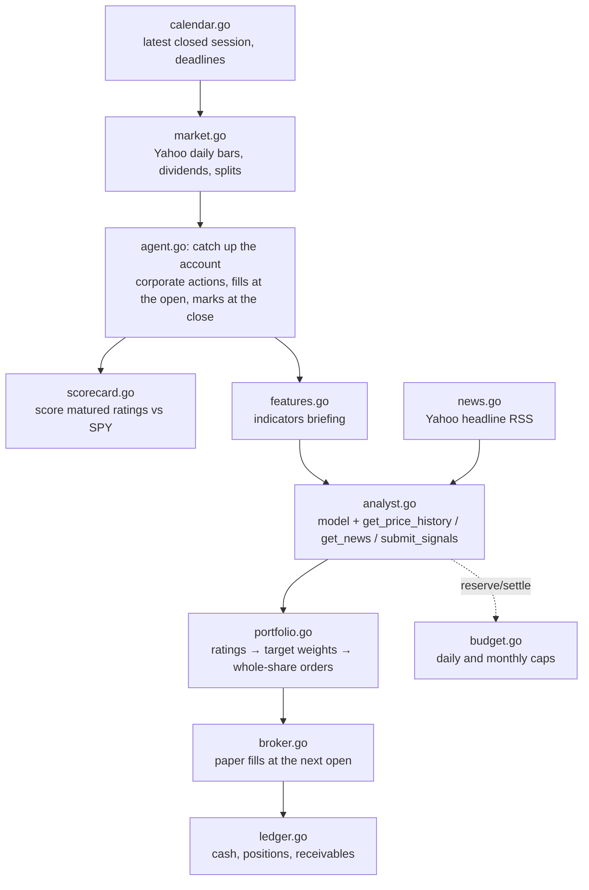

# Architecture

One Go binary and one package, `internal/trader`, with one file per responsibility. Nothing replays history: every decision is made after a real close, on data available at that moment.

## Components

| File | Responsibility |
| --- | --- |
| `calendar.go` | NYSE sessions for 2026–2027, including early closes. Finds the latest closed session, the next session and the next cycle time. Fails closed outside the reviewed years. |
| `market.go` | Downloads one year of daily bars plus dividend and split events. Validates the instrument (USD, New York exchange) and each bar's OHLC relationships. Skips incomplete rows. |
| `features.go` | Computes the indicators in the briefing: 1/5/20/60-session returns, 20/60 moving averages, 20-day volatility, volume versus its 20-day average, 1-year high and low. |
| `news.go` | Fetches the per-symbol headline RSS. Keeps the last seven days before the decision, deduplicates, strips HTML, and assigns stable `news:` IDs. |
| `analyst.go` | The model's tool loop, the request settings, the error policy and cost accounting (detailed below). |
| `signals.go` | Rating scale and the median vote across samples. An even split rounds toward `hold`. |
| `portfolio.go` | Maps ratings to target weights, applies the exposure cap (new purchases cut first), the no-trade band and the minimum trade. Also builds the benchmark's one-time equal-weight basket. |
| `broker.go` | The paper broker. Market-on-open fills with adverse slippage rounded to the cent. Sales run before purchases; purchases are rechecked against cash, exposure and position limits at the actual open. |
| `ledger.go` | Integer-cent account. Dividends become receivables on the ex-date. Splits convert shares at the open and pay fractional shares in cash; pending orders are restated in post-split shares. |
| `scorecard.go` | Each rating enters at the next open and exits at the close `horizon_sessions` later. Its return minus SPY's over the same window is its excess return. Buy and sell ratings count as hits when the sign is right; holds are only averaged. |
| `budget.go` | Durable spending journal: reserve → dispatch → settle, released, uncertain or resolved. File-locked so concurrent processes share one cap. |
| `agent.go` | Orchestrates the cycle, owns the state file and runs the daemon loop. Transient failures retry every 10 minutes; failures that retrying cannot fix wait for the next close. |
| `status.go` | Status report: agent vs benchmark, positions, orders, the last decision, scorecard and spend. |

**`analyst.go` in detail.** It calls the model through Anthropic's official Go SDK (beta Messages API). The model ID comes from `TRADER_MODEL`.

- **Tools.** Every tool uses `strict: true` with `tool_choice: auto`, because current advanced models reject a forced tool choice.
- **Request settings.** `output_config.effort` is set. Top-level prompt caching is on, so each research turn re-reads the shared prefix cheaply. `fallbacks: "default"` handles refusals.
- **Error policy.** Retryable statuses back off and retry. Other HTTP errors stop the cycle. Network failures stay charged as uncertain.
- **Cost accounting.** Costs come from per-attempt usage: cache writes are billed at 1.25× and cache reads at 0.1× the input rate.

## Why it is built this way

- **Live decisions only.** A language model may remember how past markets moved, so a replay of history can look better than the agent really is. Deciding after each real close, with orders that fill at the next open, keeps the track record honest.
- **One analyst with tools.** A single agent that gathers its own price and news evidence is simple, cheap and easy to debug. Set `samples` above 1 to get a median vote across independent runs.
- **The model rates; rules trade.** Letting a model write position sizes turns small changes of opinion into many small trades, and the commissions eat the gains. Fixed rules, a no-trade band and a minimum trade size keep sizing consistent and cheap.
- **A buy-and-hold twin.** The agent is only worth running if it beats simply holding the same stocks at the same cost, so that comparison is always on screen.

## The decision contract

The analyst's final call is `submit_signals`. For every configured symbol it must supply:

- a `rating` (`strong_sell` … `strong_buy`);
- a `confidence` (`low`, `medium`, `high`);
- a `rationale`;
- `evidence_ids`.

Strict mode enforces the shape. Go code then re-validates it and checks that every cited ID was actually shown to the model in that run. These are `prices:SYMBOL`, `market:SYMBOL`, or a news ID returned by `get_news`. A violation goes back to the model as a tool error so it can correct the submission.

Confidence is recorded for later calibration but does not change position sizes.

## One cycle, step by step

1. **Pick the session.** Take the latest session whose close plus `close_buffer_minutes` has passed. If the state already covers it, stop: nothing to do.
2. **Load market data.** Reuse the archive in `cycles/<session>/market/` if one exists. Otherwise download, and archive only once every needed bar is present; a missing bar means "data not ready, retry later".
3. **Walk forward.** For each session since the last one processed: apply splits and dividends, fill pending agent and benchmark orders at the open, mark both accounts at the close, and score matured ratings. Every session skipped this way is recorded as a missed decision.
4. **Start the benchmark.** On the first cycle only, place the benchmark's equal-weight purchase orders.
5. **Check the deadline.** If the next open is less than five minutes away, record a missed decision and hold.
6. **Research.** Run the analyst. Each finished sample is saved as `cycles/<session>/sample-N.json`, and each model response under `calls/`.
7. **Plan.** Turn the ratings into orders and add the ratings to the open scorecard.
8. **Save.** Write `cycle.json`, then `state.json`. Both writes are atomic.

A crash anywhere before the final save leaves the account unchanged. Running the cycle again reuses the archived market data and the finished samples, so the result is the same and nothing is paid twice.

## Files under `data_dir`

| Path | Contents |
| --- | --- |
| `state.json` | Both accounts, pending orders, last closes, equity history, open and scored ratings, last decision, missed decisions |
| `budget.json` | Every model-call reservation and its outcome |
| `cycles/<date>/cycle.json` | What the cycle did: fills, rejections, corporate events, scores, decision, orders, notes |
| `cycles/<date>/market/*.json` | Raw vendor payloads used by that cycle |
| `cycles/<date>/sample-N.json` | Analyst run: ratings, tool calls, news shown, model(s) that answered, estimated cost |
| `cycles/<date>/calls/*.json` | Raw API response for every model call |
| `agent.lock`, `budget.json.lock` | Locks for a single cycle writer and serialized budget edits |

## Timing rules

- A decision uses the close of session D. Its orders fill at the open of the next session at that open price, which the analyst never saw.
- If the agent is down for several sessions, the next cycle fills the pending orders at the first missed open, marks each missed close, and makes one new decision for the latest session. It never decides retroactively.
